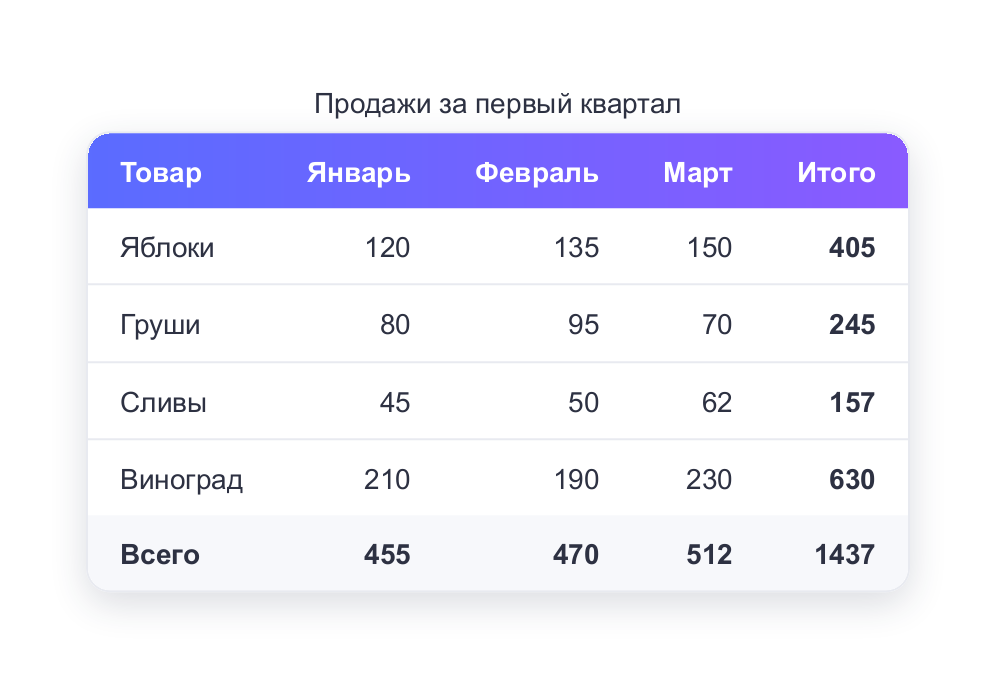
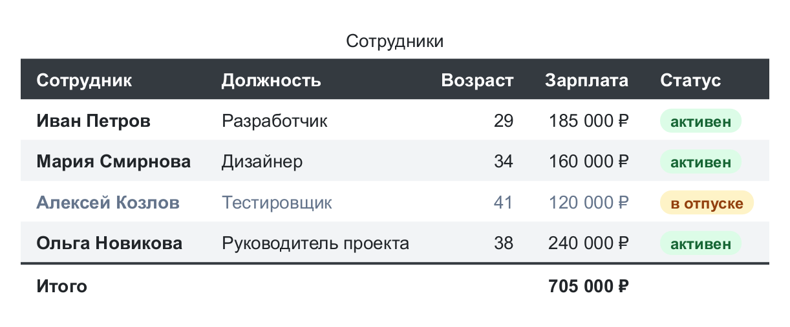
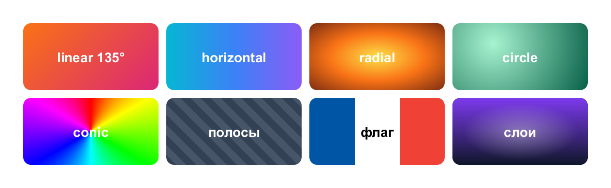
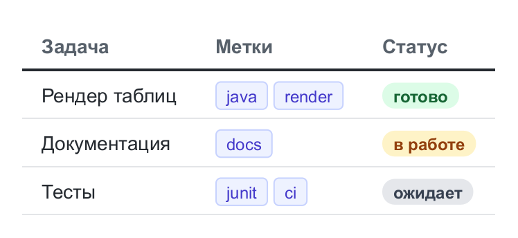
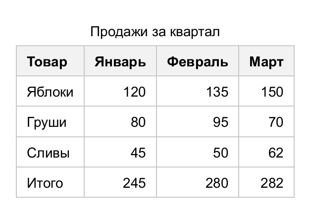
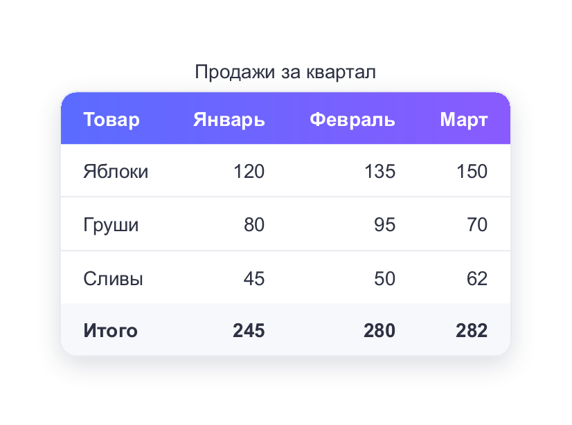

# table-renderer

Java-библиотека для рендера таблиц в изображения. Таблица описывается в коде: данные, структура
и оформление. Возможности оформления повторяют CSS: рамки, скругления, тени, градиенты, переносы
и обрезка текста, форматированный текст в ячейках, объединение ячеек. Готовая таблица сохраняется в PNG/JPEG
или рисуется на любой `Graphics2D`.

<p>


</p>
<p>


</p>

## Возможности

- **Структура как в HTML** — шапка, тела, подвал, заголовок таблицы, объединение ячеек по строкам
  и колонкам (`colspan` / `rowspan`).
- **Каскад стилей** — стиль ячейки складывается из уровней «таблица → секция → колонка → строка →
  условные правила → ячейка».
- **Условные правила вместо селекторов** — «зебра», выделение колонок, раскраска по значениям:
  `table.rule(Match.body().and(Match.evenRows()), s -> s.background(...))`.
- **Раскладка как в браузере** — автоматический и фиксированный алгоритмы ширины колонок, ширина в пикселях
  и процентах, выравнивание по базовой линии, схлопывание рамок с разрешением конфликтов по правилам CSS.
- **Оформление** — 10 стилей рамок, скругления, внешние и внутренние тени, контур, прозрачность,
  линейные, радиальные и конические градиенты, фоновые изображения.
- **Текст** — форматирование отдельных фрагментов, «бейджи», изображения в тексте, индексы, подчёркивания
  пяти стилей, тени и обводка текста, капитель, перенос по словам и внутри слов, мягкие переносы,
  многоточие, ограничение количества строк, выравнивание по ширине.
- **Шрифты** — запасные шрифты для отсутствующих символов, насыщенность 100–900, свои TTF/OTF.
- **Данные** — построение таблицы из коллекции объектов, форматирование значений, темы оформления.
- **Результат** — изображение любого масштаба (HiDPI), координаты ячеек, вывод на `Graphics2D` (SVG/PDF).

Только Java 11+ и AWT, без внешних зависимостей во время выполнения.

## Установка

Библиотека пока не опубликована в Maven Central. Соберите и установите её в локальный репозиторий:

```shell
git clone <адрес репозитория>
cd table-renderer
mvn install
```

и подключите в проект:

```xml
<dependency>
    <groupId>me.manuloff.lib</groupId>
    <artifactId>table-renderer</artifactId>
    <version>2.0-SNAPSHOT</version>
</dependency>
```

На сервере без графической среды запускайте JVM с `-Djava.awt.headless=true`.

## Быстрый старт

<!-- example: quick-start -->
```java
Table table = new Table();
table.caption("Продажи за квартал");
table.header("Товар", "Январь", "Февраль", "Март");
table.addRow("Яблоки", 120, 135, 150);
table.addRow("Груши", 80, 95, 70);
table.addRow("Сливы", 45, 50, 62);
table.footer("Итого", 245, 280, 282);

// Числа - по правому краю
table.rule(Match.column(1, 2, 3), Style::right);
```


<!-- /example -->

Тема оформления меняется одной строкой:

<!-- example: quick-start-themed -->
```java
table.theme(Themes.MODERN);
```


<!-- /example -->

Сохранение:

<!-- code: quick-start-save -->
```java
table.render().write(Path.of("table.png"));

// Чётче на экранах высокой плотности и с белым фоном
table.render(RenderOptions.builder().scale(2).background(Color.WHITE).build())
        .write(Path.of("table@2x.png"));
```
<!-- /code -->

## Документация

| Раздел                                              | Содержание                                                  |
|-----------------------------------------------------|-------------------------------------------------------------|
| [Начало работы](docs/getting-started.md)            | Первая таблица, сохранение, основные понятия                |
| [Структура таблицы](docs/structure.md)              | Секции, строки, ячейки, колонки, объединения, значения      |
| [Форматированный текст](docs/content.md)            | Фрагменты со своим стилем, бейджи, изображения, индексы     |
| [Стили](docs/styles.md)                             | Каскад стилей и справочник всех свойств                     |
| [Рамки](docs/borders.md)                            | Модели рамок, стили линий, скругления, конфликты рамок      |
| [Фон и эффекты](docs/backgrounds.md)                | Градиенты, изображения, тени, прозрачность, контур          |
| [Текст](docs/text.md)                               | Шрифты, оформление, переносы, обрезка, выравнивание         |
| [Правила и темы](docs/rules-and-themes.md)          | Условное оформление, готовые и собственные темы             |
| [Таблица из данных](docs/data.md)                   | Построение из коллекции объектов                            |
| [Рендер](docs/rendering.md)                         | Параметры, результат, геометрия, вывод на Graphics2D, шрифты |
| [Устройство библиотеки](docs/architecture.md)       | Пакеты, конвейер рендера, как вносить изменения             |

## Сборка и тесты

```shell
mvn test                                         # тесты, включая проверку актуальности документации
mvn test -Dtest=DocsTest -Ddocs.update=true      # пересобрать примеры и картинки в docs/
```

Код и картинки примеров в документации генерируются из `src/test/java/.../docs` — поэтому они всегда
компилируются и соответствуют текущей версии библиотеки.
