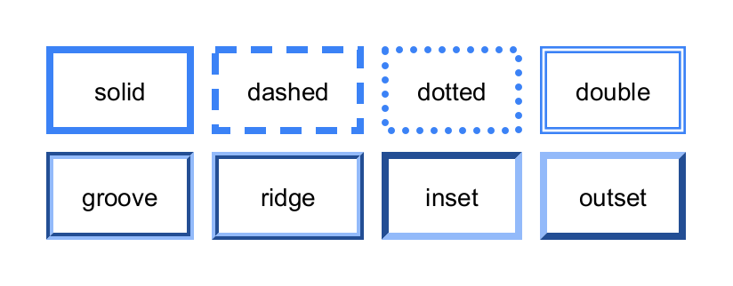
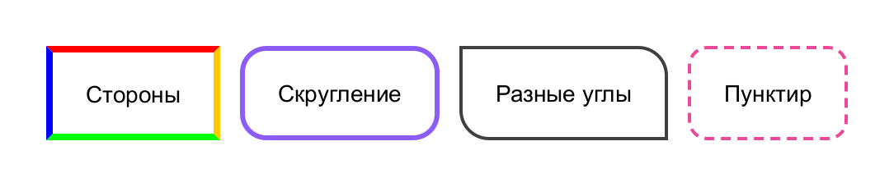
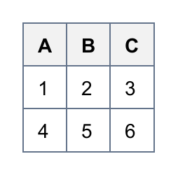
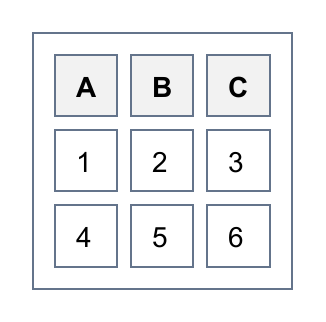
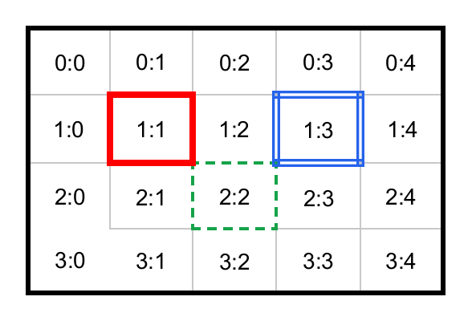
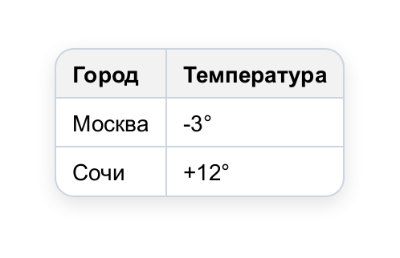

# Рамки

## Стили линий

Сторона рамки — `BorderSide`: толщина, стиль и цвет. Фабрики: `BorderSide.solid(w, color)`,
`dashed`, `dotted`, `doubled`, `of(w, style, color)`; константы `NONE` и `HIDDEN`.

<!-- example: border-styles -->
```java
Table table = new Table().theme(Themes.PLAIN);
table.style(s -> s.separate(10));
table.cellStyle(s -> s.padding(12, 16).center());

BorderStyle[] styles = {BorderStyle.SOLID, BorderStyle.DASHED, BorderStyle.DOTTED, BorderStyle.DOUBLE,
        BorderStyle.GROOVE, BorderStyle.RIDGE, BorderStyle.INSET, BorderStyle.OUTSET};
Row row = null;
for (int i = 0; i < styles.length; i++) {
    if (i % 4 == 0) row = table.addRow();
    BorderStyle style = styles[i];
    row.addCell(style.name().toLowerCase()).style(s -> s.border(4, style, new Color(0x3B82F6)));
}
```


<!-- /example -->

`GROOVE`, `RIDGE`, `INSET` и `OUTSET` рисуются двумя оттенками цвета, создавая объём.

## Стороны и скругления

<!-- example: border-sides -->
```java
Table table = new Table().theme(Themes.PLAIN);
table.style(s -> s.separate(12));
table.cellStyle(s -> s.padding(16, 20).center());
Row row = table.addRow("Стороны", "Скругление", "Разные углы", "Пунктир");
row.cell(0).style(s -> s.border(
        BorderSide.solid(4, Color.RED), BorderSide.solid(4, Color.ORANGE),
        BorderSide.solid(4, Color.GREEN), BorderSide.solid(4, Color.BLUE)));
row.cell(1).style(s -> s.border(3, new Color(0x8B5CF6)).borderRadius(16));
row.cell(2).style(s -> s.border(2, Color.DARK_GRAY).borderRadius(Corners.of(0, 18, 0, 18)));
row.cell(3).style(s -> s.border(2, BorderStyle.DASHED, new Color(0xEC4899)).borderRadius(12));
```


<!-- /example -->

| Метод `Style`                              | Что делает                                 |
|--------------------------------------------|--------------------------------------------|
| `border(side)`, `border(w, color)`, `border(w, style, color)` | Одинаковая рамка со всех сторон |
| `border(top, right, bottom, left)`         | Каждая сторона отдельно                    |
| `borderTop(...)` … `borderLeft(...)`       | Одна сторона                               |
| `borderHorizontal(side)`, `borderVertical(side)` | Верх и низ / лево и право            |
| `noBorder()`                               | Убрать рамки                               |
| `borderRadius(r)`, `borderRadius(Corners.of(tl, tr, br, bl))` | Скругление углов        |

Если сумма радиусов на стороне больше её длины, радиусы пропорционально уменьшаются (как в CSS).

## Модели рамок

### Схлопывание (по умолчанию)

Соседние ячейки делят общую рамку, линии сетки рисуются один раз. Скругление ячеек в этой модели
не применяется.

<!-- example: collapse-model -->
```java
Table table = new Table();          // по умолчанию - схлопывание рамок
table.cellStyle(s -> s.border(1, new Color(0x64748B)));
table.header("A", "B", "C");
table.addRow(1, 2, 3);
table.addRow(4, 5, 6);
```


<!-- /example -->

### Раздельная модель

`table.style(s -> s.separate(spacing))` — у каждой ячейки своя рамка, между ячейками промежутки.
Здесь работают скругления, тени ячеек и `emptyCells`.

<!-- example: separate-model -->
```java
Table table = new Table();
table.style(s -> s.separate(6).border(1, new Color(0x64748B)).padding(4));
table.cellStyle(s -> s.border(1, new Color(0x64748B)));
table.header("A", "B", "C");
table.addRow(1, 2, 3);
table.addRow(4, 5, 6);
```


<!-- /example -->

## Конфликты общих рамок

Когда соседние ячейки задают разные рамки для общей границы, побеждает одна — по правилам CSS:

1. `HIDDEN` побеждает всегда (рамки нет даже у соседей), `NONE` — проигрывает всегда;
2. более толстая рамка;
3. при равной толщине — по стилю: `DOUBLE`, `SOLID`, `DASHED`, `DOTTED`, `RIDGE`, `OUTSET`, `GROOVE`, `INSET`;
4. при равном стиле рамка ячейки сильнее рамки таблицы;
5. при полном равенстве — левая или верхняя ячейка.

<!-- example: collapse-conflicts -->
```java
Table table = new Table();
table.style(s -> s.border(BorderSide.solid(3, Color.BLACK)));
table.cellStyle(s -> s.padding(10, 14).center());
for (int r = 0; r < 4; r++) {
    Row row = table.addRow();
    for (int c = 0; c < 5; c++) row.addCell(r + ":" + c);
}
// Толще - сильнее
table.body().row(1).cell(1).style(s -> s.border(BorderSide.solid(4, Color.RED)));
// Двойная рамка и пунктир
table.body().row(1).cell(3).style(s -> s.border(BorderSide.doubled(5, new Color(0x2563EB))));
table.body().row(2).cell(2).style(s -> s.border(BorderSide.dashed(2, new Color(0x16A34A))));
// HIDDEN убирает рамку даже у соседей
table.body().row(3).cell(0).style(s -> s.borderTop(BorderSide.HIDDEN).borderRight(BorderSide.HIDDEN));
```


<!-- /example -->

## Скруглённая таблица

Скругление таблицы обрезает её содержимое. В модели схлопывания одинаковая внешняя рамка рисуется
скруглённым контуром.

<!-- example: rounded-table -->
```java
Table table = new Table();
Color line = new Color(0xCBD5E1);
table.style(s -> s.borderRadius(12).border(1, line)
        .boxShadow(Shadow.of(0, 4, 12, new Color(0, 0, 0, 30))).margin(12));
table.cellStyle(s -> s.border(1, line));
table.header("Город", "Температура");
table.addRow("Москва", "-3°");
table.addRow("Сочи", "+12°");
```


<!-- /example -->
