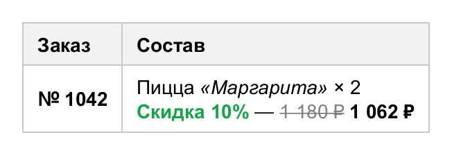
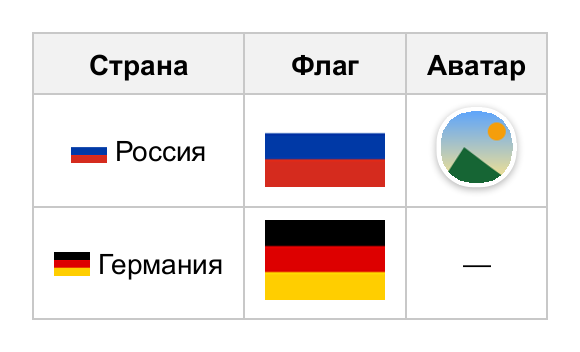
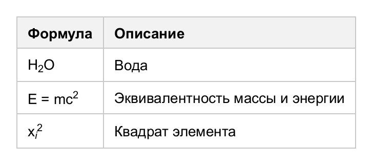

# Форматированный текст

`RichText` — содержимое ячейки или заголовка из фрагментов с разным оформлением, переносов строк
и изображений. Его можно передать значением ячейки или заполнить через `cell.content(c -> ...)`.

<!-- example: rich-text -->
```java
Table table = new Table();
table.header("Заказ", "Состав");
RichText order = new RichText()
        .text("Пицца ")
        .text("«Маргарита»", s -> s.italic())
        .text(" × 2").br()
        .text("Скидка 10%", s -> s.color(new Color(0x16A34A)).bold())
        .text(" — ")
        .text("1 180 ₽", s -> s.lineThrough().color(Color.GRAY))
        .bold(" 1 062 ₽");
table.addRow("№ 1042", order).cell(0).style(Style::bold);
```


<!-- /example -->

| Метод                                  | Что добавляет                                  |
|----------------------------------------|------------------------------------------------|
| `text("...")`                          | Текст                                          |
| `text("...", s -> ...)`                | Фрагмент со своим стилем                       |
| `bold("...")`, `italic("...")`         | Жирный текст, курсив                           |
| `span(s -> ..., c -> ...)`             | Вложенный фрагмент с произвольным содержимым   |
| `br()`                                 | Перенос строки                                 |
| `image(img)`, `image(img, w, h, s -> ...)` | Изображение в тексте                       |
| `append(inline)`, `append(richText)`   | Готовые узлы                                   |

Символы `\n` в тексте тоже переносят строку (при стиле `WhiteSpace` по умолчанию — `PRE_LINE`).

## Наследование

Фрагмент наследует текстовые свойства ячейки (шрифт, цвет, размер, переносы) и переопределяет заданные.
Свойства блока — фон, рамка, скругление, отступы, тень — у фрагмента собственные: они рисуются вокруг
текста фрагмента. Линии оформления (подчёркивание и т.д.) распространяются на вложенные фрагменты.

## Бейджи

Фон, отступы и скругление фрагмента превращают его в «бейдж». Горизонтальные отступы и рамка
учитываются при раскладке, вертикальные — только рисуются, не увеличивая высоту строки.
Если фрагмент переносится на следующую строку, края (рамка, скругление) есть только у его начала и конца.

<!-- example: badges -->
```java
Table table = new Table().theme(Themes.MINIMAL);
table.header("Задача", "Метки", "Статус");
table.addRow("Рендер таблиц", tags("java", "render"), badge("готово", 0xDCFCE7, 0x166534));
table.addRow("Документация", tags("docs"), badge("в работе", 0xFEF3C7, 0x92400E));
table.addRow("Тесты", tags("junit", "ci"), badge("ожидает", 0xE5E7EB, 0x374151));
```


<!-- /example -->

Вспомогательные методы из примера:

<!-- code: badges-helpers -->
```java
static Span badge(String text, int background, int color) {
    return Span.of(text, s -> s
            .background(new Color(background)).color(new Color(color))
            .bold().fontSize(12).padding(2, 8).borderRadius(9));
}

static RichText tags(String... names) {
    RichText text = new RichText();
    for (String name : names) {
        text.text(name, s -> s
                .background(new Color(0xEEF2FF)).color(new Color(0x4338CA)).fontSize(12)
                .padding(2, 7).borderRadius(4).border(1, new Color(0xC7D2FE)));
        text.text(" ");
    }
    return text;
}
```
<!-- /code -->

## Изображения

Изображение стоит на базовой линии текста. Из стиля используются размеры отступов, рамка, скругление
(изображение обрезается по нему), тень, прозрачность и `baselineOffset` — подъём над базовой линией
(отрицательный — опускание, удобно для иконок рядом с текстом).

<!-- example: inline-images -->
```java
Table table = new Table();
table.header("Страна", "Флаг", "Аватар");

Row row = table.addRow();
row.addCell(null).content(c -> c.image(ru, 18, 12, s -> s.baselineOffset(-1)).text(" Россия"));
row.addCell(ru);                                     // изображение как значение ячейки
row.addCell(null).content(c -> c.image(avatar, 36, 36, s -> s
        .borderRadius(18).border(2, Color.WHITE)
        .boxShadow(Shadow.of(0, 1, 4, new Color(0, 0, 0, 80)))));

table.addRow(new RichText().image(de, 18, 12, s -> s.baselineOffset(-1)).text(" Германия"), de, "—");
table.cellStyle(s -> s.center());
```


<!-- /example -->

Способ вписывания в заданный размер — `new InlineImage(img, w, h).fit(ObjectFit.COVER)`.

## Индексы

<!-- example: sub-sup -->
```java
Table table = new Table();
table.header("Формула", "Описание");
table.addRow(new RichText().text("H").text("2", s -> s.sub().fontSize(10)).text("O"), "Вода");
table.addRow(new RichText().text("E = mc").text("2", s -> s.sup().fontSize(10)), "Эквивалентность массы и энергии");
table.addRow(new RichText().text("x").text("i", s -> s.sub().fontSize(10).italic())
        .text("2", s -> s.sup().fontSize(10)), "Квадрат элемента");
```


<!-- /example -->
