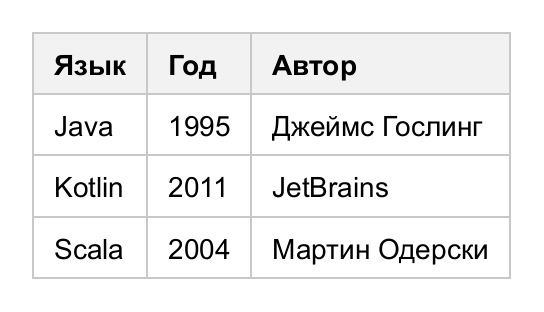

# Таблица из данных

## Из коллекции объектов

`Table.from(items)` возвращает построитель: каждая колонка описывается заголовком и функцией,
извлекающей значение из элемента. В примере `staff` — список сотрудников (`List<Employee>`),
`badge(...)` — вспомогательный метод из раздела [«Бейджи»](content.md#бейджи).

<!-- example: builder -->
```java
double total = staff.stream().mapToDouble(Employee::getSalary).sum();

Table table = Table.from(staff)
        .column("Сотрудник", Employee::getName, c -> c.style(Style::bold))
        .column("Должность", Employee::getPosition)
        .column("Возраст", Employee::getAge, c -> c.style(Style::right).headerStyle(Style::right))
        .column("Зарплата", Employee::getSalary, c -> c
                .format((Double v) -> String.format("%,.0f ₽", v))
                .style(Style::right).headerStyle(Style::right))
        .column("Статус", Employee::isActive, c -> c
                .cell((cell, e) -> cell.value(e.isActive()
                        ? badge("активен", 0xDCFCE7, 0x166534)
                        : badge("в отпуске", 0xFEF3C7, 0x92400E))))
        .onRow((row, e) -> {
            if (!e.isActive()) row.style(s -> s.color(new Color(0x64748B)));
        })
        .footer("Итого", "", "", String.format("%,.0f ₽", total), "")
        .configure(t -> t
                .theme(Themes.STRIPED)
                .caption("Сотрудники")
                .rule(Match.foot().and(Match.column(3)), Style::right))
        .build();
```


<!-- /example -->

| Метод `TableBuilder`                   | Что делает                                                     |
|----------------------------------------|----------------------------------------------------------------|
| `column(header, extractor)`            | Колонка                                                        |
| `column(header, extractor, c -> ...)`  | Колонка с настройкой (см. ниже)                                |
| `onRow((row, item) -> ...)`            | Настройка строки по элементу (подсветка, стиль)                |
| `footer(values...)`                    | Строка подвала                                                 |
| `withoutHeader()`                      | Без шапки                                                      |
| `configure(table -> ...)`              | Настройка готовой таблицы: тема, правила, заголовок            |
| `build()`                              | Новая таблица                                                  |

Настройка колонки (`ColumnSpec`):

| Метод                              | Что делает                                                              |
|------------------------------------|-------------------------------------------------------------------------|
| `format((Double v) -> ...)`        | Преобразование значения (для `null` не вызывается)                      |
| `style(s -> ...)`                  | Стиль ячеек колонки в теле                                              |
| `headerStyle(s -> ...)`            | Стиль ячейки шапки                                                      |
| `width(px)`, `width(Size)`         | Ширина колонки                                                          |
| `cell((cell, item) -> ...)`        | Произвольная настройка ячейки: значение, содержимое, стиль              |

Значение колонки сохраняется в ячейке, поэтому по нему работают [условные правила](rules-and-themes.md).

## Из массивов

<!-- example: builder-simple -->
```java
Table table = Table.of(
        new Object[]{"Язык", "Год", "Автор"},
        new Object[][]{
                {"Java", 1995, "Джеймс Гослинг"},
                {"Kotlin", 2011, "JetBrains"},
                {"Scala", 2004, "Мартин Одерски"}
        });
```


<!-- /example -->

Строки также добавляются из `Iterable`: `table.addRow(List.of(...))`, `row.addCells(list)`.
