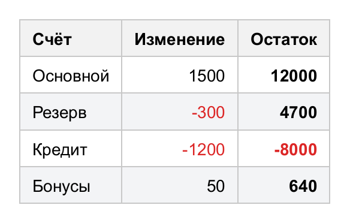
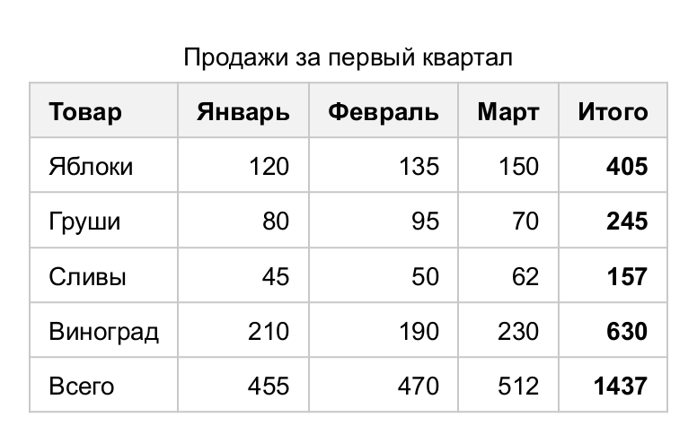
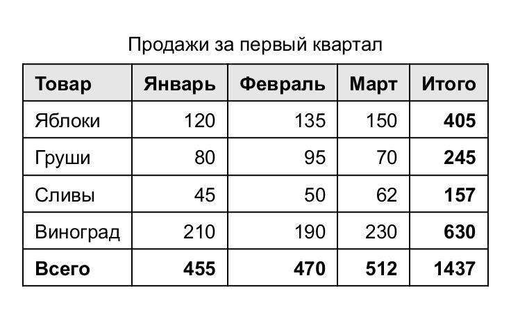
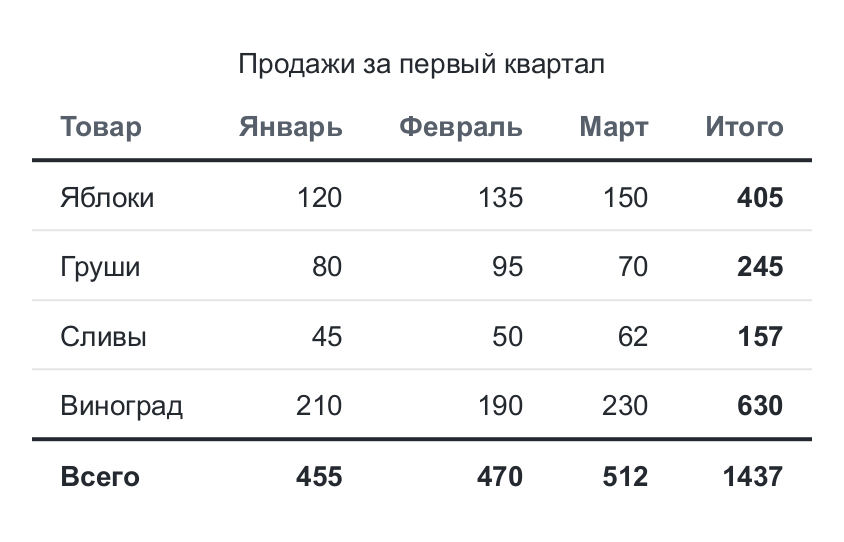
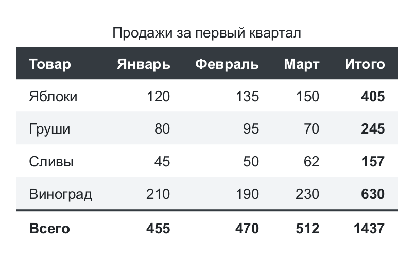
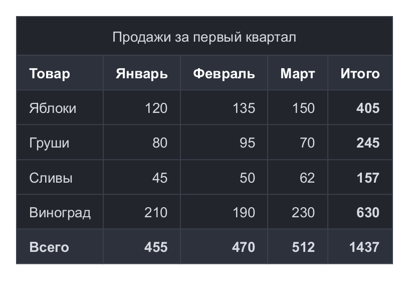
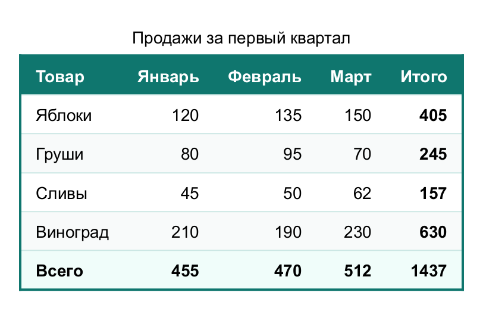

# Правила и темы

## Условные правила

Правило — условие выбора ячеек и стиль для них. Правила заменяют CSS-селекторы вроде `:nth-child`
и применяются после стиля строки, но до стиля самой ячейки, в порядке добавления.

<!-- example: rules -->
```java
Table table = new Table();
table.header("Счёт", "Изменение", "Остаток");
table.addRow("Основной", 1500, 12000);
table.addRow("Резерв", -300, 4700);
table.addRow("Кредит", -1200, -8000);
table.addRow("Бонусы", 50, 640);

// "Зебра" в теле таблицы
table.rule(Match.body().and(Match.evenRows()), s -> s.background(new Color(0xF3F4F6)));
// Числовые колонки - вправо
table.rule(Match.column(1, 2), Style::right);
// Отрицательные числа - красным
table.rule(Match.numeric().and(Match.value(v -> ((Number) v).doubleValue() < 0)),
        s -> s.color(new Color(0xDC2626)));
// Своё условие: последняя колонка в теле - жирная
table.rule(c -> c.isLastColumn() && !c.isHeader(), Style::bold);
```


<!-- /example -->

### Готовые условия (`Match`)

| Условие                                      | Ячейки                                               |
|----------------------------------------------|------------------------------------------------------|
| `all()`                                      | Все                                                  |
| `head()`, `body()`, `foot()`, `section(kind)`| Секции                                               |
| `headerCells()`                              | Заголовочные (шапка и `addHeaderCell`)               |
| `row(i...)`, `firstRow()`, `lastRow()`       | Строки секции по индексу                             |
| `evenRows()`, `oddRows()`                    | Чётные и нечётные по счёту строки секции («зебра»)  |
| `everyRow(step, offset)`                     | Каждая step-я строка, начиная с offset               |
| `column(i...)`, `firstColumn()`, `lastColumn()` | Колонки                                           |
| `evenColumns()`, `oddColumns()`              | Чётные и нечётные колонки                            |
| `value(predicate)`, `numeric()`              | По значению ячейки                                   |
| `not(m)`, `m.and(other)`, `m.or(other)`, `m.negate()` | Комбинации                                  |

### Свои условия

`CellMatcher` — функциональный интерфейс, условие можно написать лямбдой. `CellContext` даёт ячейку,
строку, секцию, значение и положение в сетке:

| Метод                                     | Значение                                             |
|-------------------------------------------|------------------------------------------------------|
| `cell()`, `row()`, `section()`, `value()` | Объекты модели и значение ячейки                     |
| `rowIndex()`, `rowCount()`                | Индекс строки и количество строк в секции            |
| `tableRowIndex()`                         | Индекс строки среди всех строк таблицы               |
| `columnIndex()`, `columnCount()`          | Колонка, в которой начинается ячейка, и число колонок |
| `isHeader()`, `isFirstRow()`, `isLastRow()`, `isFirstColumn()`, `isLastColumn()` | Признаки положения |

```java
table.rule(c -> c.tableRowIndex() < 3 && c.columnIndex() > 0, s -> s.background(Color.YELLOW));
```

## Темы

Тема — набор стилей, применяемый к таблице целиком: `table.theme(Themes.STRIPED)`.
Тема сбрасывает оформление блока таблицы, стили ячеек, секций и заголовка и задаёт свои. Размеры таблицы,
стили строк, колонок, ячеек и пользовательские правила сохраняются. Правила предыдущей темы удаляются,
поэтому темы можно переключать.

| `Themes.DEFAULT` (по умолчанию)                                    | `Themes.GRID`                                                |
|--------------------------------------------------------------------|--------------------------------------------------------------|
| <!-- image: theme-default --><!-- /image -->                       | <!-- image: theme-grid --><!-- /image -->                    |
| **`Themes.MINIMAL`**                                               | **`Themes.STRIPED`**                                         |
| <!-- image: theme-minimal --><!-- /image -->                       | <!-- image: theme-striped --><!-- /image -->                 |
| **`Themes.DARK`**                                                  | **`Themes.MODERN`**                                          |
| <!-- image: theme-dark --><!-- /image -->                          | <!-- image: theme-modern --><!-- /image -->                  |

`Themes.PLAIN` — без оформления: чистый лист для своего стиля.

### Своя тема

Тема — функция `Table → void`. Правила темы добавляйте через `themeRule(...)`, чтобы они заменялись
при смене темы:

<!-- code: custom-theme -->
```java
static final Theme CORPORATE = table -> {
    Color brand = new Color(0x0F766E);
    Themes.PLAIN.apply(table);                         // начать с чистого листа
    table.style().border(BorderSide.solid(2, brand)).background(Color.WHITE);
    table.cellStyle().padding(7, 12).borderBottom(BorderSide.solid(1, new Color(0xCCE7E4)));
    table.head().style().bold().color(Color.WHITE).background(brand);
    table.foot().style().bold().background(new Color(0xF0FDFA));
    table.themeRule(Match.body().and(Match.evenRows()), s -> s.background(new Color(0xF8FAFA)));
};
```
<!-- /code -->

<!-- example: custom-theme-usage -->
```java
Table table = sales().theme(CORPORATE);
```


<!-- /example -->
