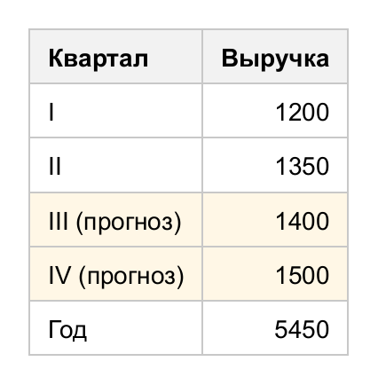
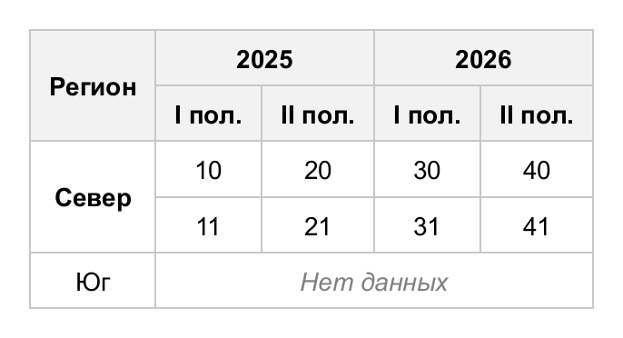
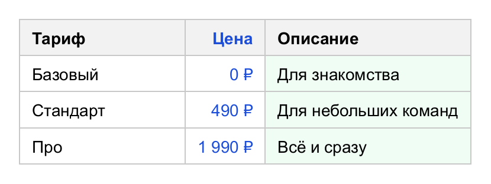
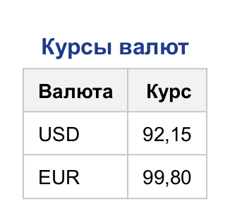
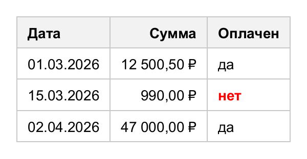

# Структура таблицы

Модель повторяет HTML-таблицу:

```
Table
├── Caption              заголовок (над или под таблицей)
├── Column               колонки: ширина и стиль
├── Section HEAD         шапка (thead)
├── Section BODY ...     одно или несколько тел (tbody)
└── Section FOOT         подвал (tfoot)
    └── Row
        └── Cell         значение или форматированный текст, colspan / rowspan
```

## Секции

Шапка всегда рисуется первой, подвал — последним, независимо от порядка заполнения. Тел может быть
несколько: каждое — отдельная группа строк со своим стилем; объединение строк не выходит за пределы группы.

<!-- example: sections -->
```java
Table table = new Table();
table.header("Квартал", "Выручка");          // шапка
table.addRow("I", 1200);                      // первое тело
table.addRow("II", 1350);

Section second = table.addBody();             // второе тело - отдельная группа строк
second.style(s -> s.background(new Color(0xFFF7E6)));
second.addRow("III (прогноз)", 1400);
second.addRow("IV (прогноз)", 1500);

table.footer("Год", 5450);                    // подвал - всегда внизу
table.rule(Match.column(1), Style::right);
```


<!-- /example -->

| Метод                                     | Что делает                                    |
|-------------------------------------------|-----------------------------------------------|
| `table.header(values...)`                 | Строка в шапку (ячейки заголовочные)          |
| `table.addRow(values...)`                 | Строка в последнее тело                       |
| `table.footer(values...)`                 | Строка в подвал                               |
| `table.head()` / `body()` / `foot()`      | Секции для настройки и добавления строк       |
| `table.addBody()`                         | Новое тело                                    |
| `section.addRow(...)`, `section.row(i)`   | Добавление и получение строки                 |
| `row.addCell(value)`, `row.addCells(...)` | Добавление ячеек                              |
| `row.addHeaderCell(value)`                | Заголовочная ячейка в теле (заголовок строки) |
| `row.cell(i)`, `row.height(px)`           | Ячейка по индексу, минимальная высота строки  |

## Объединение ячеек

`colspan` и `rowspan` работают как в HTML: ячейка занимает несколько колонок или строк, следующие ячейки
занимают первые свободные места.

<!-- example: spans -->
```java
Table table = new Table();
table.cellStyle(s -> s.center());

Row top = table.head().addRow();
top.addCell("Регион").rowspan(2);
top.addCell("2025").colspan(2);
top.addCell("2026").colspan(2);
table.header("I пол.", "II пол.", "I пол.", "II пол.");

Row north = table.addRow();
north.addHeaderCell("Север").rowspan(2);       // заголовок строки на две строки
north.addCells(10, 20, 30, 40);
table.addRow(11, 21, 31, 41);                  // первая колонка занята объединением

Row south = table.addRow("Юг");
south.addCell("Нет данных").colspan(4).style(s -> s.italic().color(Color.GRAY));
```


<!-- /example -->

## Колонки

Стиль колонки применяется к ячейкам, которые в ней начинаются. Ширина колонки (`width`) задаёт ширину самой
колонки, а фон рисуется одной полосой на всю её высоту.

<!-- example: columns -->
```java
Table table = new Table();
table.column(0).width(140);                                // ширина колонки
table.column(1).style(s -> s.right().color(new Color(0x1D4ED8)));
table.column(2).style(s -> s.background(new Color(0xF0FDF4)));  // фон - через всю колонку

table.header("Тариф", "Цена", "Описание");
table.addRow("Базовый", "0 ₽", "Для знакомства");
table.addRow("Стандарт", "490 ₽", "Для небольших команд");
table.addRow("Про", "1 990 ₽", "Всё и сразу");
```


<!-- /example -->

Ширина — в пикселях (`width(140)`) или процентах от ширины таблицы (`width(Size.percent(30))`).
Содержимое шире заданного значения всё равно расширит колонку; чтобы этого не было, используйте
[фиксированную раскладку](styles.md#таблица-tablestyle) или обрезку текста.

## Заголовок

Заголовок занимает ширину таблицы, по умолчанию стоит над ней и наследует текстовые свойства ячеек.
Положение меняется через `table.style(s -> s.captionSide(CaptionSide.BOTTOM))`.

<!-- example: caption -->
```java
Table table = new Table();
table.caption(c -> c
        .text("Курсы валют")
        .style(s -> s.bold().fontSize(16).color(new Color(0x1E3A8A))));
table.header("Валюта", "Курс");
table.addRow("USD", "92,15");
table.addRow("EUR", "99,80");
table.rule(Match.column(1), Style::right);
```


<!-- /example -->

## Значения и форматирование

Ячейка хранит исходное значение. При отрисовке оно превращается в содержимое:

| Значение                         | Как выводится                                        |
|----------------------------------|------------------------------------------------------|
| `null`                           | Пустая ячейка                                        |
| `String`, `CharSequence`         | Как есть                                             |
| `RichText`, `Span`               | [Форматированный текст](content.md)                  |
| `BufferedImage`                  | Изображение в исходном размере                       |
| Остальное                        | `table.formatter(...)`, по умолчанию `String.valueOf` |

Так как значение сохраняется, условные правила могут оформлять ячейки по данным:

<!-- example: values -->
```java
DateTimeFormatter dates = DateTimeFormatter.ofPattern("dd.MM.yyyy");
Table table = new Table()
        .formatter(v -> {
            if (v instanceof BigDecimal) return String.format("%,.2f ₽", v);
            if (v instanceof LocalDate) return ((LocalDate) v).format(dates);
            if (v instanceof Boolean) return (Boolean) v ? "да" : "нет";
            return String.valueOf(v);
        });
table.header("Дата", "Сумма", "Оплачен");
table.addRow(LocalDate.of(2026, 3, 1), new BigDecimal("12500.5"), true);
table.addRow(LocalDate.of(2026, 3, 15), new BigDecimal("990"), false);
table.addRow(List.of(LocalDate.of(2026, 4, 2), new BigDecimal("47000"), true));

// Значение доступно правилам - оформление по данным
table.rule(Match.value(Boolean.FALSE::equals), s -> s.color(Color.RED).bold());
table.rule(Match.column(1), Style::right);
```


<!-- /example -->

Явное содержимое (`cell.content(c -> ...)`) имеет приоритет над значением.
