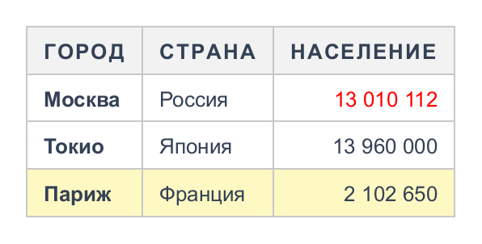

# Стили

Оформление описывается двумя классами:

- `Style` — стиль ячеек, заголовка таблицы и фрагментов текста;
- `TableStyle` — стиль блока таблицы: рамка, фон, тень, размеры, модель рамок.

Методы стиля возвращают сам стиль, поэтому их удобно вызывать цепочкой внутри лямбды:

```java
cell.style(s -> s.bold().color(Color.RED).padding(4, 8).border(1, Color.GRAY));
```

## Каскад

Свойство `Style` может быть не задано — тогда оно берётся с более общего уровня. Итоговый стиль ячейки
складывается в таком порядке (каждый следующий уровень перекрывает заданные свойства предыдущего):

1. значения по умолчанию (см. справочник ниже), для заголовочных ячеек — жирный шрифт;
2. `table.cellStyle()` — все ячейки;
3. `section.style()` — шапка, тело или подвал;
4. `table.column(i).style()` — колонка;
5. `row.style()` — строка;
6. условные правила `table.rule(...)` в порядке добавления;
7. `cell.style()` — сама ячейка.

<!-- example: cascade -->
```java
Table table = new Table();
table.cellStyle(s -> s.fontSize(13).color(new Color(0x334155)));     // 1. все ячейки
table.head().style(s -> s.uppercase().letterSpacing(1));             // 2. секция
table.column(2).style(s -> s.right());                              // 3. колонка
table.header("Город", "Страна", "Население");
table.addRow("Москва", "Россия", "13 010 112");
table.addRow("Токио", "Япония", "13 960 000");
table.addRow("Париж", "Франция", "2 102 650")
        .style(s -> s.background(new Color(0xFEF9C3)));            // 4. строка
table.rule(Match.body().and(Match.column(0)), s -> s.bold());        // 5. правило
table.body().row(0).cell(2).style(s -> s.color(Color.RED));         // 6. ячейка
```


<!-- /example -->

Особые случаи:

- **фон секции, колонки и строки** не копируется в ячейки, а рисуется отдельным слоем на всю их площадь
  (как в CSS) — градиент шапки идёт одной полосой; фон самой ячейки рисуется поверх;
- **ширина колонки** задаёт ширину колонки, а не каждой её ячейки;
- **фрагменты текста** наследуют только текстовые свойства (см. [форматированный текст](content.md)).

Полезные методы `Style`: `copy()`, `apply(other)` (перенести заданные свойства другого стиля),
`clear()` (сбросить всё), `isEmpty()`.

## Справочник: ячейка (`Style`)

Аналоги CSS указаны для ориентира.

### Фон и оформление блока

| Свойство                                   | По умолчанию | CSS                     | Описание                                             |
|--------------------------------------------|--------------|-------------------------|------------------------------------------------------|
| `background(Color)`                        | нет          | `background-color`      | Цвет фона                                            |
| `background(BackgroundLayer...)`           | нет          | `background-image`      | [Градиенты и изображения](backgrounds.md); первый — верхний |
| `borderTop/Right/Bottom/Left(BorderSide)`  | нет          | `border-*`              | Рамка стороны; `border(...)` — все стороны           |
| `borderRadius(r)`, `borderRadius(Corners)` | 0            | `border-radius`         | Скругление (не применяется к ячейкам при схлопывании рамок) |
| `padding(...)`, `paddingTop(...)` и др.    | 0            | `padding`               | Внутренние отступы                                   |
| `boxShadow(Shadow...)`                     | нет          | `box-shadow`            | Внешние и внутренние тени                            |
| `outline(BorderSide)`, `outlineOffset(px)` | нет, 0       | `outline`               | Контур снаружи рамки, не влияет на размеры           |
| `opacity(0..1)`                            | 1            | `opacity`               | Прозрачность ячейки целиком                          |
| `hidden(true)`                             | false        | `visibility: hidden`    | Не рисовать, сохранив место                          |
| `overflow(Overflow.HIDDEN)`                | `VISIBLE`    | `overflow`              | Обрезать содержимое по области под рамкой            |

### Размеры и выравнивание

| Свойство                         | По умолчанию   | CSS              | Описание                                                      |
|----------------------------------|----------------|------------------|---------------------------------------------------------------|
| `width(px)`, `widthPercent(%)`   | по содержимому | `width`          | Ширина с отступами и рамкой; проценты — от ширины таблицы     |
| `minWidth(px)`, `maxWidth(px)`   | нет            | `min/max-width`  | Ограничения ширины; при `maxWidth` текст переносится          |
| `height(px)`, `maxHeight(px)`    | нет            | `height`         | Минимальная и максимальная высота                             |
| `textAlign(TextAlign)`           | `LEFT`         | `text-align`     | `LEFT`, `CENTER`, `RIGHT`, `JUSTIFY`; удобно: `left()`, `right()` |
| `verticalAlign(VerticalAlign)`   | `MIDDLE`       | `vertical-align` | `TOP`, `MIDDLE`, `BOTTOM`, `BASELINE`; `center()` — по центру в обе стороны |

### Шрифт и текст

| Свойство                              | По умолчанию     | CSS                     | Описание                                         |
|---------------------------------------|------------------|-------------------------|--------------------------------------------------|
| `fontFamily(String...)`               | `SansSerif`      | `font-family`           | Семейства в порядке приоритета                   |
| `fontSize(px)`                        | 14               | `font-size`             | Размер шрифта                                    |
| `fontWeight(1..1000)`, `bold()`       | 400              | `font-weight`           | Насыщенность; константы `Style.LIGHT`, `BOLD` и др. |
| `italic()`                            | false            | `font-style`            | Курсив                                           |
| `smallCaps(true)`                     | false            | `font-variant`          | Капитель                                         |
| `kerning(bool)`, `ligatures(bool)`    | true             | `font-kerning`          | Кернинг и лигатуры                               |
| `color(Color)`                        | чёрный           | `color`                 | Цвет текста                                      |
| `lineHeight(k)`                       | по шрифту ≈1.15  | `line-height`           | Высота строки — множитель размера шрифта         |
| `letterSpacing(px)`, `wordSpacing(px)`| 0                | `letter/word-spacing`   | Интервалы                                        |
| `textIndent(px)`                      | 0                | `text-indent`           | Отступ первой строки                             |
| `textTransform(...)`, `uppercase()`   | `NONE`           | `text-transform`        | `UPPERCASE`, `LOWERCASE`, `CAPITALIZE`           |
| `textDecoration(...)`, `underline()`, `lineThrough()`, `overline()` | нет | `text-decoration` | Линии, стиль, цвет, толщина |
| `textShadow(Shadow...)`               | нет              | `text-shadow`           | Тени текста                                      |
| `textStroke(px, Color)`               | нет              | `-webkit-text-stroke`   | Обводка букв                                     |

### Переносы и обрезка

| Свойство                           | По умолчанию | CSS              | Описание                                                  |
|------------------------------------|--------------|------------------|-----------------------------------------------------------|
| `whiteSpace(WhiteSpace)`, `nowrap()` | `PRE_LINE` | `white-space`    | Пробелы и переносы; `\n` в тексте по умолчанию переносит строку |
| `wordBreak(WordBreak)`             | `NORMAL`     | `word-break`     | `BREAK_ALL` — разрыв между любыми символами               |
| `overflowWrap(OverflowWrap)`       | `NORMAL`     | `overflow-wrap`  | `BREAK_WORD`, `ANYWHERE` — разрыв длинных слов            |
| `hyphens(bool)`                    | true         | `hyphens`        | Мягкие переносы `­`                                  |
| `tabSize(n)`                       | 8            | `tab-size`       | Ширина табуляции                                          |
| `textOverflow(String)`, `ellipsis()` | `""`       | `text-overflow`  | Маркер обрезки при `overflow(HIDDEN)` или `lineClamp`     |
| `lineClamp(n)`                     | нет          | `line-clamp`     | Не больше n строк                                         |

### Фрагменты текста

| Свойство                     | По умолчанию | CSS              | Описание                               |
|------------------------------|--------------|------------------|----------------------------------------|
| `sub()`, `sup()`             | нет          | `vertical-align` | Нижний и верхний индекс                |
| `baselineOffset(px)`         | 0            | `vertical-align` | Подъём над базовой линией              |

## Справочник: таблица (`TableStyle`)

| Свойство                                   | По умолчанию   | CSS               | Описание                                               |
|--------------------------------------------|----------------|-------------------|--------------------------------------------------------|
| `background(Color)`, `background(layers...)` | нет          | `background`      | Фон таблицы                                            |
| `border(...)`, `borderTop(...)` и др.      | нет            | `border`          | Рамка таблицы                                          |
| `borderRadius(...)`                        | 0              | `border-radius`   | Скругление; содержимое обрезается по нему              |
| `padding(...)`                             | 0              | `padding`         | Отступ между рамкой и ячейками (раздельная модель)     |
| `margin(...)`                              | 0              | `margin`          | Пустое место вокруг таблицы на изображении             |
| `boxShadow(...)`, `outline(...)`, `opacity(...)` | нет      |                   | Тени, контур, прозрачность таблицы                     |
| `width(px)`, `widthPercent(%)`             | по содержимому | `width`           | Ширина таблицы; проценты — от `RenderOptions.availableWidth` |
| `minWidth(px)`, `maxWidth(px)`, `height(px)` | нет          |                   | Ограничения размеров                                   |
| `collapse()`, `separate(spacing)`          | `collapse()`   | `border-collapse` | [Модель рамок](borders.md)                             |
| `layout(TableLayout)`                      | `AUTO`         | `table-layout`    | `FIXED` — ширины колонок не зависят от содержимого     |
| `captionSide(CaptionSide)`                 | `TOP`          | `caption-side`    | Положение заголовка                                    |
| `emptyCells(EmptyCells)`                   | `SHOW`         | `empty-cells`     | `HIDE` — не рисовать пустые ячейки (раздельная модель) |

### Фиксированная раскладка

При `layout(TableLayout.FIXED)` и заданной ширине таблицы ширины колонок берутся из `table.column(i)` и ячеек
первой строки, остаток делится поровну. Содержимое на ширину не влияет — это быстро и предсказуемо,
длинный текст переносится или обрезается.

```java
table.style(s -> s.layout(TableLayout.FIXED).width(640));
table.column(0).width(80);
table.column(1).width(Size.percent(50));
```
