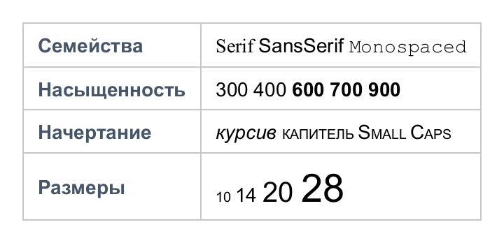
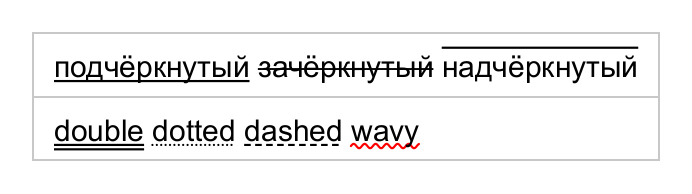
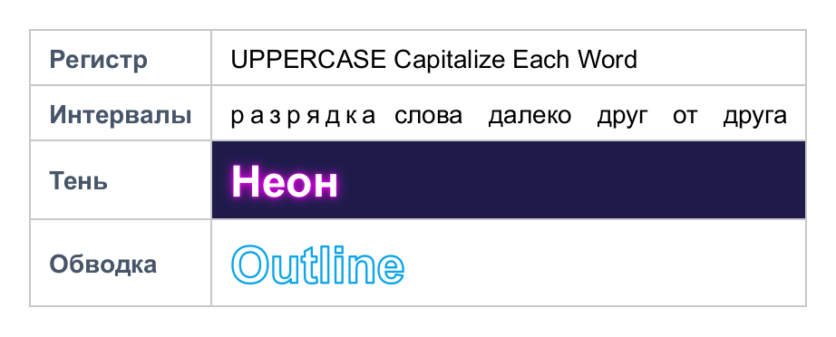
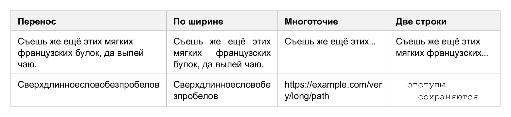
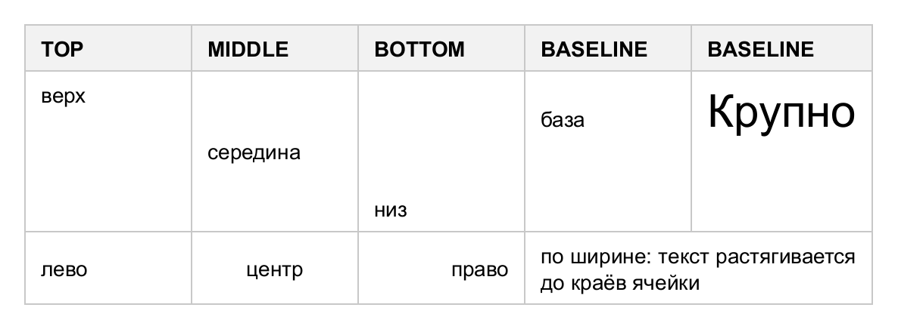

# Текст

## Шрифты

<!-- example: fonts -->
```java
Table table = new Table();
table.column(0).style(s -> s.bold().color(new Color(0x475569)));
table.addRow("Семейства", new RichText()
        .text("Serif ", s -> s.fontFamily("Serif"))
        .text("SansSerif ", s -> s.fontFamily("SansSerif"))
        .text("Monospaced", s -> s.fontFamily("Monospaced")));
table.addRow("Насыщенность", new RichText()
        .text("300 ", s -> s.fontWeight(Style.LIGHT))
        .text("400 ")
        .text("600 ", s -> s.fontWeight(Style.SEMI_BOLD))
        .text("700 ", s -> s.fontWeight(Style.BOLD))
        .text("900", s -> s.fontWeight(Style.BLACK)));
table.addRow("Начертание", new RichText()
        .italic("курсив ")
        .text("капитель Small Caps", s -> s.smallCaps(true)));
table.addRow("Размеры", new RichText()
        .text("10 ", s -> s.fontSize(10))
        .text("14 ")
        .text("20 ", s -> s.fontSize(20))
        .text("28", s -> s.fontSize(28)));
```


<!-- /example -->

- `fontFamily(...)` принимает семейства в порядке приоритета: установленные в системе, логические
  имена Java (`SansSerif`, `Serif`, `Monospaced`, `Dialog`) и общие имена CSS (`sans-serif`, `serif`, `monospace`).
- Символы, которых нет в шрифтах стиля (эмодзи, иероглифы), берутся из запасных шрифтов
  [`RenderOptions.fallbackFonts`](rendering.md#параметры).
- Насыщенность 1–1000: от 600 — жирное начертание; если установлены семейства-начертания
  («Segoe UI Semibold», «Arial Black»), они подбираются автоматически.
- Свои шрифты подключаются через [`Fonts.register`](rendering.md#шрифты).

## Оформление

<!-- example: decorations -->
```java
Table table = new Table();
table.cellStyle(s -> s.fontSize(15));
table.addRow(new RichText()
        .text("подчёркнутый", Style::underline).text("   ")
        .text("зачёркнутый", Style::lineThrough).text("   ")
        .text("надчёркнутый", Style::overline));
table.addRow(new RichText()
        .text("double", s -> s.textDecoration(TextDecoration.underline().withStyle(TextDecorationStyle.DOUBLE)))
        .text("   ")
        .text("dotted", s -> s.textDecoration(TextDecoration.underline().withStyle(TextDecorationStyle.DOTTED)))
        .text("   ")
        .text("dashed", s -> s.textDecoration(TextDecoration.underline().withStyle(TextDecorationStyle.DASHED)))
        .text("   ")
        .text("wavy", s -> s.textDecoration(TextDecoration.underline()
                .withStyle(TextDecorationStyle.WAVY).withColor(Color.RED))));
```


<!-- /example -->

`TextDecoration` задаёт линии (`underline`, `overline`, `lineThrough` — можно несколько сразу),
стиль (`SOLID`, `DOUBLE`, `DOTTED`, `DASHED`, `WAVY`), цвет, толщину и смещение подчёркивания:

```java
s.textDecoration(TextDecoration.underline().withStyle(TextDecorationStyle.WAVY).withColor(Color.RED).withThickness(2d))
```

<!-- example: text-effects -->
```java
Table table = new Table();
table.column(0).style(s -> s.bold().color(new Color(0x475569)));
table.addRow("Регистр", new RichText()
        .text("uppercase ", Style::uppercase)
        .text("capitalize each word", s -> s.textTransform(TextTransform.CAPITALIZE)));
table.addRow("Интервалы", new RichText()
        .text("разрядка ", s -> s.letterSpacing(3))
        .text("слова далеко друг от друга", s -> s.wordSpacing(10)));
table.addRow("Тень", new RichText()
        .text("Неон", s -> s.fontSize(24).bold().color(Color.WHITE)
                .textShadow(Shadow.of(0, 0, 6, new Color(0xFF00FF)), Shadow.of(0, 0, 2, new Color(0xFF00FF)))))
        .cell(1).style(s -> s.background(new Color(0x1E1B4B)));
table.addRow("Обводка", new RichText()
        .text("Outline", s -> s.fontSize(28).bold().color(Color.WHITE).textStroke(1.2, new Color(0x0EA5E9))));
```


<!-- /example -->

## Переносы и обрезка

<!-- example: wrapping -->
```java
Table table = new Table();
table.cellStyle(s -> s.width(170).verticalAlign(VerticalAlign.TOP));
table.header("Перенос", "По ширине", "Многоточие", "Две строки");
Row row = table.addRow(LOREM, LOREM, LOREM, LOREM);
row.cell(1).style(s -> s.textAlign(TextAlign.JUSTIFY));
row.cell(2).style(Style::ellipsis);
row.cell(3).style(s -> s.lineClamp(2));

Row second = table.addRow(word, word, "https://example.com/very/long/path", "  отступы\n\tсохраняются");
second.cell(1).style(s -> s.overflowWrap(OverflowWrap.ANYWHERE));
second.cell(2).style(s -> s.wordBreak(WordBreak.BREAK_ALL));
second.cell(3).style(s -> s.whiteSpace(WhiteSpace.PRE).fontFamily("Monospaced").tabSize(4));
```


<!-- /example -->

| Задача                                  | Стиль                                                       |
|-----------------------------------------|-------------------------------------------------------------|
| Перенос по словам                       | по умолчанию; ширину ограничивает `width`/`maxWidth` ячейки или `availableWidth` |
| Без переносов                           | `nowrap()`                                                  |
| Одна строка с многоточием               | `ellipsis()` + ширина ячейки                                |
| Не больше N строк                       | `lineClamp(n)`                                              |
| Разрыв длинных слов                     | `overflowWrap(OverflowWrap.ANYWHERE)` или `BREAK_WORD`      |
| Разрыв между любыми символами           | `wordBreak(WordBreak.BREAK_ALL)`                            |
| Сохранить пробелы и табуляцию           | `whiteSpace(WhiteSpace.PRE)` / `PRE_WRAP`                   |
| Перенос с дефисом в заданном месте      | мягкий перенос `­` в тексте                            |
| Свой маркер обрезки                     | `textOverflow("→")`                                         |

Различие `ANYWHERE` и `BREAK_WORD`: при `ANYWHERE` колонка может сужаться до одного символа,
при `BREAK_WORD` длинное слово рвётся, только если не помещается в уже определённую ширину.

## Выравнивание

<!-- example: alignment -->
```java
Table table = new Table();
table.cellStyle(s -> s.width(110));
table.header("TOP", "MIDDLE", "BOTTOM", "BASELINE", "BASELINE");
Row row = table.addRow("верх", "середина", "низ", "база", new RichText().text("Крупно", s -> s.fontSize(30)));
row.height(90);
row.cell(0).style(s -> s.verticalAlign(VerticalAlign.TOP));
row.cell(2).style(s -> s.verticalAlign(VerticalAlign.BOTTOM));
row.cell(3).style(s -> s.verticalAlign(VerticalAlign.BASELINE));
row.cell(4).style(s -> s.verticalAlign(VerticalAlign.BASELINE));

Row second = table.addRow("лево", "центр", "право", "по ширине: текст растягивается до краёв ячейки");
second.cell(1).style(s -> s.textAlign(TextAlign.CENTER));
second.cell(2).style(Style::right);
second.cell(3).colspan(2).style(s -> s.textAlign(TextAlign.JUSTIFY));
```


<!-- /example -->

- По горизонтали: `LEFT`, `CENTER`, `RIGHT`, `JUSTIFY` (последняя строка и строки перед явным переносом —
  по левому краю).
- По вертикали: `TOP`, `MIDDLE`, `BOTTOM`, `BASELINE` — первые строки всех таких ячеек строки таблицы
  выравниваются по общей базовой линии.
